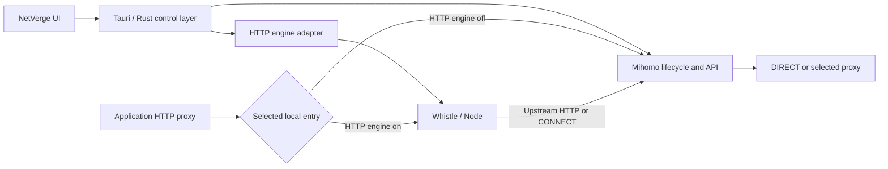

# NetVerge 双引擎冗余与复用分析 V0.1

> 状态：架构调研 / 待验证。本文只确定职责边界与验证顺序，不批准功能开发或主分支合并。
> 对象：Windows 桌面客户端，保留 Clash Verge Rev 的代理能力，补足类似 Surge 的 HTTP 调试能力。

## 1. 分析范围与证据

- Clash Verge Rev：NetVerge Fork 的 dev 基线 [09da5a6](https://github.com/dompling/NetVerge/tree/09da5a6a696a2979fac1cacdb06e284632ebcc06)，版本 2.6.0。下文的 CVR 指桌面客户端及其 Mihomo 内核能力；两者不能混为一个网络引擎。
- Whistle：上游源码快照 [e039fd8](https://github.com/avwo/whistle/tree/e039fd86bc70928b0de7abc2f71a1612d530b370)，其 master 的 package.json 报告 2.10.15。npm 发布包与此快照的一致性尚未验证。
- NetVerge 已提交的独立原型 [1c184df](https://github.com/dompling/NetVerge/commit/1c184dfcd8e6fc22065c04677eb02a5a3cb8fef3) 尚未执行测试、尚未接入 Tauri；保留为实验，不视为已完成集成。

方法：检查源码目录与关键实现、配置、接口，按能力粒度区分真正重复、表面相似、独有能力。没有运行基准测试，也没有逐行做两个仓库的代码相似度计算，因此不提供虚构的冗余百分比或性能数字。Mihomo 内核内部实现本轮未完整审查。

## 2. 核心结论

**不要合并两个网络内核的内部实现，也不要把 Whistle 当成第二个完整桌面客户端。**

CVR 负责操作系统、桌面生命周期和代理配置；Mihomo 负责网络转发、DNS 与出口决策；Whistle 负责 HTTP 语义处理。三者之间只有一套用户配置入口，按能力分派给不同引擎。界面复用优先于复制，已有能力能通过适配器调用则不重写。

重叠最明显的是代理入口、系统代理设置、DNS、规则存储、日志、连接监控和进程生命周期。容易误判的是 JavaScript 脚本、网络连接与 HTTP 请求、分流规则与重写规则：它们名字相近，但不是同一种能力。

## 3. 能力重叠矩阵

等级：高 = 需要明确唯一主责；部分 = 存在共同基础，但语义或层级不同；无 = 独有功能或没有发现可等价复用的实现。等级表示能力重叠，不是代码重复率。

| 能力 | CVR / Mihomo | Whistle | 重叠 | NetVerge 决策 |
|---|---|---|---|---|
| HTTP 代理入口 | mixed / HTTP 入口 | HTTP 代理、CONNECT | 高 | 系统代理模式下只暴露一个选中的入口；Whistle 开启时串联 Mihomo |
| SOCKS5 | 内核入口及协议支持 | lib/index.js 可启动 SOCKS 服务 | 高 | 保留 Mihomo；Whistle 不启动额外 SOCKS 入口 |
| 系统代理 / PAC | sysopt、proxy_control、guard | bin/proxy.js | 高（系统代理） | CVR 独占系统写入；不调用 Whistle 的 proxy/init |
| TUN / 非 HTTP 流量 | Mihomo、服务、TUN 配置 | HTTP/TLS/WebSocket 代理，不是通用 TUN | 无 | 保留 CVR；首阶段不串联 TUN |
| DNS | Mihomo DNS、配置与覆盖 | lib/rules/dns.js，本地缓存和 DoH | 高 | Mihomo 主责；Whistle 必需的内部解析保留，禁止第二套独立 DNS UI |
| Hosts / DNS 覆盖 | Mihomo hosts / DNS | host 规则、系统 hosts 接口 | 部分 | 默认由 Mihomo 管理；HTTP 专用覆盖与路由冲突需单独定义，不修改系统 hosts |
| 代理出口 / 路由 | 节点、策略组、规则分流 | proxy/socks/host 等规则 | 高 | Mihomo 主责；Whistle proxy 类规则默认受限，不宣称 catch-all 是强制出口 |
| 代理订阅 | profiles、provider、定时更新 | 规则/插件导入与更新 | 部分 | 保留 CVR 订阅；HTTP 模块独立资源类型，可共享下载与 UI 外壳 |
| 规则引擎 | 目的地址、域名、进程等分流 | URL、方法、头、正文等操作匹配 | 部分 | 路由规则和 HTTP Rewrite 分开，不强行翻译成一套语法 |
| 配置存储 / 排序 | profiles、草稿、配置回滚 | rules/storage、rules/util、values | 部分 | 统一产品入口；各引擎保留其原生存储。避免同一字段双写 |
| JavaScript | enhance/script.rs，Boa 配置增强 | 插件与动态 HTTP 规则 | 部分（运行时概念） | 保留两种执行环境；不能用配置脚本替代逐请求脚本 |
| 连接与日志 | connections、Mihomo API、logger | get-data、get-session、data-server | 部分 | 共用表格/筛选组件，保留连接与 HTTP 请求两种数据模型 |
| 流量计量 | Mihomo 流量及连接统计 | HTTP 请求、正文与时间信息 | 部分 | 总流量以 Mihomo 为准；HTTP 数据是子集，不能叠加 |
| 生命周期 / 健康检查 | CoreManager、runstate、service | foreground、CLI、状态接口 | 部分 | 复用桌面生命周期的模式、事件和错误处理；HTTP 引擎独立状态 |
| TLS MITM / CA | 非 HTTP 解密核心职责 | https/ca、tunnel、cert API | 无（等价能力） | 直接复用 Whistle；用户主动授权信任 CA，按域名选择 |
| HTTP 请求和响应修改 | 非既有核心能力 | inspectors/req、res、handlers | 无（等价能力） | 复用原生解析、替换、Mock 能力 |
| 请求重放 / WebSocket 调试 | 连接管理不是请求重放 | composer、socket-mgr、frames | 无（等价能力） | 复用 Whistle 的能力，按需做界面适配 |
| 桌面 UI、托盘、设置、更新 | Tauri / React / MUI | WebUI、CLI 及另有桌面实现 | 部分 | 仅 CVR 作为桌面壳；Whistle WebUI 可用于早期本地调试，不另起桌面进程 |

## 4. 源码证据与复用落点

### 4.1 系统代理与生命周期

CVR：
- [core/sysopt.rs](https://github.com/dompling/NetVerge/blob/09da5a6a696a2979fac1cacdb06e284632ebcc06/src-tauri/src/core/sysopt.rs)：系统代理/PAC 写入顺序、状态锁、守护退出、失败恢复；当前 update_sysproxy 使用 MixedPort::desired()。
- [core/proxy_control.rs](https://github.com/dompling/NetVerge/blob/09da5a6a696a2979fac1cacdb06e284632ebcc06/src-tauri/src/core/proxy_control.rs)：系统代理控制及错误归类。
- [config/mixed_port.rs](https://github.com/dompling/NetVerge/blob/09da5a6a696a2979fac1cacdb06e284632ebcc06/src-tauri/src/config/mixed_port.rs)：区分期望端口与内核实时生效端口；effective() 查询内核并回退，故返回端口不等同健康证明。
- [core/manager/lifecycle.rs](https://github.com/dompling/NetVerge/blob/09da5a6a696a2979fac1cacdb06e284632ebcc06/src-tauri/src/core/manager/lifecycle.rs)：内核启动、停止、替换、服务与 sidecar 的恢复流程。

Whistle：[index.js](https://github.com/avwo/whistle/blob/e039fd86bc70928b0de7abc2f71a1612d530b370/index.js) 可作为模块启动；[bin/proxy.js](https://github.com/avwo/whistle/blob/e039fd86bc70928b0de7abc2f71a1612d530b370/bin/proxy.js) 自带系统代理操作；CLI --init 还可能自动安装 CA。

复用结论：不调用 Whistle 的系统代理工具，沿用 CVR 的现有所有者/守护和错误处理。新增一个“有效系统代理目标”抽象时必须覆盖 PAC、守护及异常恢复路径，不能只把 sysopt 中一个端口替换为 8899。Whistle 不应进入 Mihomo 的提权服务，也不复制整套 CoreManager。

### 4.2 DNS、分流与规则

- CVR [config/dns.rs](https://github.com/dompling/NetVerge/blob/09da5a6a696a2979fac1cacdb06e284632ebcc06/src-tauri/src/config/dns.rs)、[feat/dns.rs](https://github.com/dompling/NetVerge/blob/09da5a6a696a2979fac1cacdb06e284632ebcc06/src-tauri/src/feat/dns.rs) 已有 DNS 配置与覆盖入口。
- Whistle [lib/rules/dns.js](https://github.com/avwo/whistle/blob/e039fd86bc70928b0de7abc2f71a1612d530b370/lib/rules/dns.js) 有 DNS/DoH/缓存；[proxy 规则说明](https://github.com/avwo/whistle/blob/e039fd86bc70928b0de7abc2f71a1612d530b370/docs/en/docs/rules/proxy.md) 明确 host 和 proxy 同时匹配时默认 host 优先，可改变优先级。
- Whistle [lib/rules/util.js](https://github.com/avwo/whistle/blob/e039fd86bc70928b0de7abc2f71a1612d530b370/lib/rules/util.js) 已实现规则文件选择、排序、默认规则、值等管理。

复用结论：HTTP 请求进入 Mihomo 时尽量保留目标域名；不能假设 Whistle 永远不会自行 DNS 解析，必须测实际 CONNECT、HTTP 转发、域名改写与 DNS 请求。Mihomo 的进程匹配可能看到 Whistle/Node 进程而非原始应用，不能承诺原分流语义完全不变。初期 HTTP 规则只开放请求/响应改写和可控 Mock，暂不开放任意出口/hosts 覆盖。原型 shadowRules 中的 catch-all 仅是默认路由，不是安全边界。

### 4.3 脚本

- [enhance/script.rs](https://github.com/dompling/NetVerge/blob/09da5a6a696a2979fac1cacdb06e284632ebcc06/src-tauri/src/enhance/script.rs) 使用 Boa 对配置执行增强，存在输出大小、循环次数和超时限制。
- [lib/plugins/index.js](https://github.com/avwo/whistle/blob/e039fd86bc70928b0de7abc2f71a1612d530b370/lib/plugins/index.js) 管理插件和 HTTP 生命周期相关钩子；[inspectors/req.js](https://github.com/avwo/whistle/blob/e039fd86bc70928b0de7abc2f71a1612d530b370/lib/inspectors/req.js) 与 [inspectors/res.js](https://github.com/avwo/whistle/blob/e039fd86bc70928b0de7abc2f71a1612d530b370/lib/inspectors/res.js) 已实现请求/响应改写。

复用结论：配置增强与流量脚本是不同场景，只共享编辑器、日志显示和模块配置等外围设施。Surge 的 $request、$response、$done 等接口不能凭空认为 Whistle 支持，后期按 API 合同实现适配，不再独立实现 HTTP 改写内核。插件默认关闭，未信任脚本不得自动获得本机权限。

### 4.4 监控与 UI

- CVR [pages/connections.tsx](https://github.com/dompling/NetVerge/blob/09da5a6a696a2979fac1cacdb06e284632ebcc06/src/pages/connections.tsx)、src/components/connection/、src/components/profile/、src/services/ 已有连接列表、编辑、事件与 API 基础。
- [utils/connections_stream.rs](https://github.com/dompling/NetVerge/blob/09da5a6a696a2979fac1cacdb06e284632ebcc06/src-tauri/src/utils/connections_stream.rs) 已实现 Mihomo 流量流的有界通道和消费模式。
- Whistle [get-data.js](https://github.com/avwo/whistle/blob/e039fd86bc70928b0de7abc2f71a1612d530b370/biz/webui/cgi-bin/get-data.js)、[get-session.js](https://github.com/avwo/whistle/blob/e039fd86bc70928b0de7abc2f71a1612d530b370/biz/webui/cgi-bin/get-session.js)、[data-server.js](https://github.com/avwo/whistle/blob/e039fd86bc70928b0de7abc2f71a1612d530b370/lib/util/data-server.js) 提供请求增量数据、单会话和有界缓存。

复用结论：先复用 Whistle WebUI 做开发验证，再通过受控后端适配这些接口；接口稳定性、认证、分页及缓存清理需要验证。不将上游任意 WebUI 直接加载进拥有 Tauri 权限的主窗口。请求列表复用现有表格、筛选、详情组件，数据模型分开。HTTP/2 多路复用使连接和请求不能可靠一对一匹配。请求头、正文、Cookie 不默认持久化，日志脱敏，禁止双重流量累计。

### 4.5 证书

Whistle [lib/https/ca.js](https://github.com/avwo/whistle/blob/e039fd86bc70928b0de7abc2f71a1612d530b370/lib/https/ca.js) 管理签发，[bin/ca/index.js](https://github.com/avwo/whistle/blob/e039fd86bc70928b0de7abc2f71a1612d530b370/bin/ca/index.js) 有平台安装逻辑。复用证书引擎，不重写 TLS；Windows 信任/撤销操作由桌面控制层统一显式授权，独立 CA 私钥、限制访问，避免自动全局解密。Whistle 配置默认上游证书校验为 false，原型使用 safe 模式；正式版本须验证校验行为及失败处理。

## 5. 推荐架构与替代方案

控制面和数据面分离：Rust 管控进程、配置与 OS 代理，不进入每个 HTTP 数据包的处理链；Whistle 只处理明确选择的 HTTP 代理流量，Mihomo 继续作为唯一默认网络出口。默认关闭 HTTP 引擎，不自动安装证书。初期仅支持系统 HTTP 代理模式，PAC、TUN、代理守护与端口迁移未验证之前不对外承诺组合使用。

| 方案 | 复用程度（定性） | 风险 | 结论 |
|---|---|---|---|
| CVR 主壳 + Whistle 独立 sidecar | 高 | 双进程、串联、进程识别与 DNS | 推荐验证 |
| 两个完整客户端拼接 | 表面高 | 双系统代理、双设置、重复 UI | 不采用 |
| 将 Whistle 全部移植到 Rust/Go | 低 | HTTP/TLS 兼容、长期维护 | 不采用 |
| 为 Mihomo 自写 MITM/Rewrite | 中 | 核心维护、协议与证书复杂度 | 暂不采用 |

不以进程数量为唯一优化目标。是否拆为 sidecar 由故障隔离、可维护性、包体与实际性能决定。

## 6. 冗余处理清单

| 类别 | 保留 / 禁用 / 暂缓 |
|---|---|
| 完整保留 | Mihomo、CVR 的订阅、规则分流、节点、TUN、系统代理、托盘、设置、备份基础；Whistle 的 HTTP 解析、MITM、Rewrite、Mock、请求采集 |
| 禁用重复入口 | Whistle 独立系统代理开关、自动 CA 安装、额外 SOCKS/HTTP/HTTPS 专用监听端口（默认不启动）、独立桌面壳、独立自动更新、系统 hosts 写入入口 |
| 合并外围能力 | 日志展示、编辑器、页面外壳、配置导入导出入口、下载管理、生命周期事件与错误提示 |
| 保留独立模型 | 路由规则 vs HTTP 规则，连接 vs 请求，配置 JS vs 请求 JS，Mihomo 流量统计 vs HTTP 诊断指标 |
| 暂缓 | TUN+MITM、通用 Surge 模块兼容、任意脚本执行、全局解密、双引擎连接关联与品牌重构 |

禁用指产品默认不启用或不暴露，初期不删除上游代码，避免扩大 Fork 的维护差异。具体限制必须由实现与测试确认，不是仅隐藏 UI。

## 7. 分步实施与验收门槛

每阶段单独审查，不并行扩展。当前停在阶段 0。

| 阶段 | 内容 | 通过条件 |
|---|---|---|
| 0 架构调研 | 本文、能力归属、冲突清单 | 明确唯一主责及首阶段范围；确认后才进入下一阶段 |
| 1 原型验证 | 使用现有 engines/whistle，真实 Mihomo + 受控测试服务器 | HTTP 改写、HTTP 转发、HTTPS CONNECT、正常 TLS 校验；节点与 DIRECT 分流正确；未授权时不更改 OS/证书；记录失败案例 |
| 2 单入口生命周期 | 独立状态与进程管理，复用 CVR 系统代理状态机 | 启动成功才切换；关闭先恢复原目标；端口冲突、崩溃、退出和配置变化不留下失效代理 |
| 3 最小 UI | 开关、状态、请求列表、基本 Rewrite | 默认关闭、原 CVR 功能无回归；HTTP 数据受控且总流量不重复 |
| 4 MITM | 证书安装/撤销、指定域名 | 显式授权、信任边界、私钥存储、证书锁定与失败提示 |
| 5 发布准备 | Windows 打包、锁定依赖、运行时与发布身份 | 独立安装路径/应用标识、禁用原上游更新签名与发布端点、许可证及第三方声明、无 Node 全局安装要求 |
| 后续 | Surge 兼容与 TUN 研究 | 单独方案审查；原应用进程归属、DNS、QUIC、UDP、回环与策略选择实测后再决定 |

阶段 1 需记录基准：原 CVR、HTTP 引擎开启但无解密、选择性解密三个场景的冷启动、RSS/CPU、HTTP 延迟 p50/p95、吞吐、连接数、请求缓存增长。保持同一机器、协议、测试负载；同时记录包体与空闲资源。当前无测量结果，不以估算代替数据。

## 8. 待确认问题与风险优先级

| 优先级 | 问题 | 验证方式 |
|---|---|---|
| P0 | Whistle → Mihomo 是否保持出口策略与域名 | 实际 Mihomo 日志及受控目标比对；含重定向/CONNECT |
| P0 | 是否出现回环、双系统代理或崩溃后断网 | 单所有者状态机、杀进程及端口切换实验 |
| P0 | 未改写规则是否可能绕过预期上游 | host/proxy 优先级、插件与本地 Mock 行为，失败路径 |
| P0 | 原始应用进程信息是否丢失 | 对比 Mihomo 连接元数据；必要时限定功能范围 |
| P0 | 本机控制面、CA、请求敏感内容是否暴露 | loopback、认证、权限、日志脱敏、证书生命周期 |
| P1 | Whistle 数据 API 是否足够稳定 | 锁版本、增量拉取、并发、缓存回收、接口错误 |
| P1 | Node/Whistle 运行时是否值得整包内置 | Windows 打包验证、包体/RSS 实测、依赖锁定 |
| P1 | PAC/TUN、QUIC 与 DNS 共存 | 独立阶段验证，不默认为兼容 |

## 9. 本轮决策

- 当前分支 feat/whistle-integration 保留已有实验提交，不合并 dev。
- 本轮仅新增本文，不改代码、不启动发布、不删除现有模块。
- 下一步先审查本文，再对原型进行阶段 1 验证，而不是继续写 UI、证书或 Surge 兼容代码。
